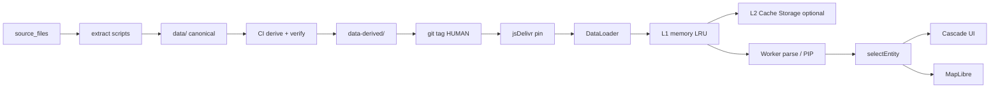

# 02 — Architecture

Cross-links: [CDN files](./03-cdn-file-plan.md) · [Selection contract](./04-selection-contract.md) · [Caching](./07-caching.md) · [Roadmap](./11-roadmap.md)

## Derive model (required)

```text
source_files/  (immutable)
    → extract scripts → data/          CANONICAL (GeoAgent / Landmark)
    → CI derive/verify → data-derived/ CONSUMER PUBLISH (tag contents for CDN)
    → git tag vX.Y.Z-national (HUMAN)
    → jsDelivr …@vX.Y.Z-national/data-derived/   (or publish root aliased at tag time)
    → Client DataLoader → L1 → (L2 SW) → Worker parse/PIP → selectEntity
    → Cascade UI → MapLibre
```

Canonical `data/` remains the SoT for agents. Consumer apps pin the **derived** root after P1; until then P0 optimizes against current `data/` URLs.

## Components

| Component | Responsibility |
|---|---|
| Git canonical `data/` | Areas, places shards, boundaries, reviews (reviews not in consumer contract) |
| CI derive | Slim catalog, children shards, places index/detail/search, hash gates |
| jsDelivr | Immutable tag CDN; HTTP/2; br/gzip |
| DataLoader | Deterministic URLs, concurrency 4–6, single-flight, L1 LRU |
| Worker | JSON/GeoJSON parse; bbox prefilter + point-in-polygon; never invent geom |
| selectEntity | Contract in [04](./04-selection-contract.md); AbortSignal + progress |
| Cascade UI | verified children only; unnamed places hidden |
| MapLibre | exact/partial/none paint; native cluster; chunked setData |

## Data flow



## Client module sketch (plan only)

- `PinContext` — base URL + `dataset_version` from manifest  
- `DataLoader.fetchJson(url)` — L0/L1/single-flight  
- `selectEntity(ref, opts)` — parallel boundary ∥ places; Worker filter for hoods  
- Active chain pin: country → city → rayon → hood → place never evicted from L1 while selected  

## Hierarchy modes (client must support)

1. City → rayon → hood (Bakı, Gəncə)  
2. City-direct (Sumqayıt, …)  
3. Country → rayon → settlement (Abşeron, Xızı, …) — union rules in [05](./05-place-sources-and-neighborhoods.md)

## Compat

P0: no URL change (canonical `data/`). P1: HUMAN pin PR switches `DEFAULT_DATA_BASE` to derived root (`data-derived/`); dual-read allowed during one release. Path map: [03](./03-cdn-file-plan.md). Master prompt: [PROMPT](./PROMPT.md).
